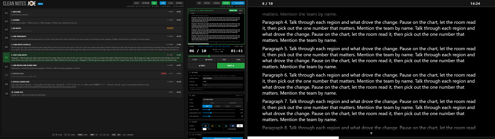
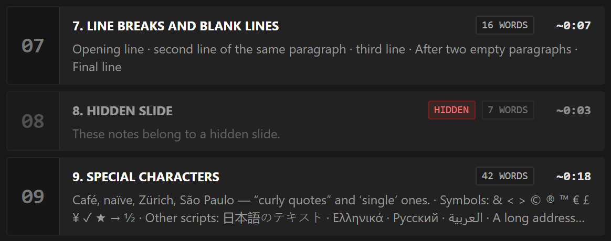
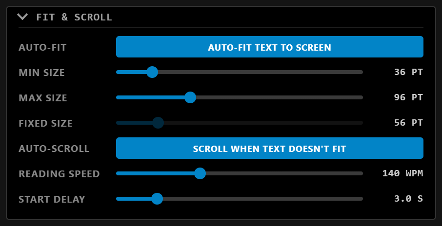
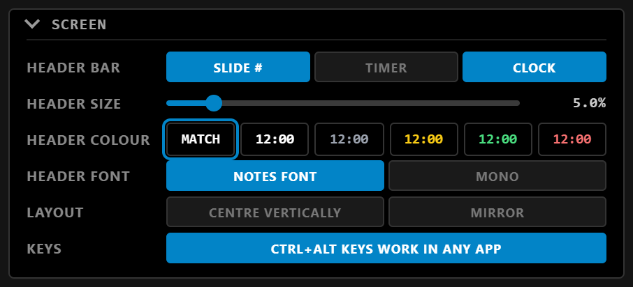
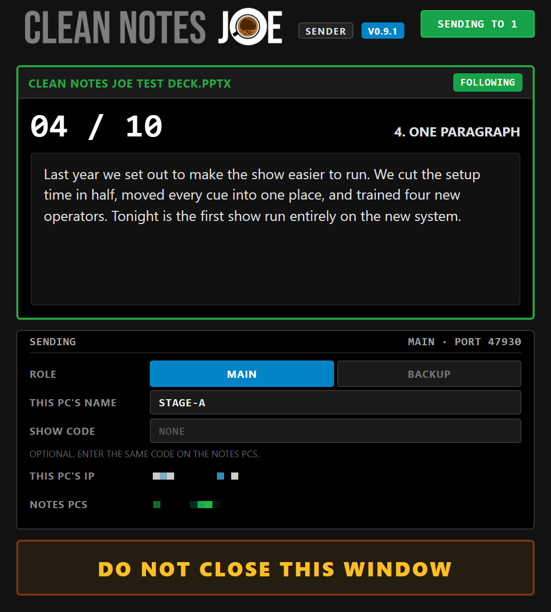
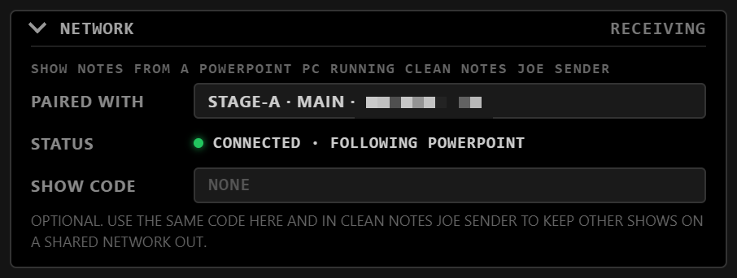

# Clean Notes Joe
Designed by Joseph Stracuzzi

**Your speaker notes, big and clean on a second screen.** Load a PowerPoint or LibreOffice Impress deck, or let Clean Notes Joe follow the presentation that's running. The notes for the current slide fill a fullscreen display, sized to fit, and scroll at reading pace when there's too much to fit. A companion to [Playback Joe](https://github.com/josephstracuzzi/playback-joe).



---

## ⬇️ Download
Get the latest version from the **[Releases page](https://github.com/josephstracuzzi/clean-notes-joe/releases/latest)**. Both apps are portable: nothing to install, just download and run.

| App | Use it on |
|---|---|
| **Clean Notes Joe** | The computer with the notes screen. On its own it reads a deck file or follows PowerPoint / LibreOffice on the same computer. |
| **Clean Notes Joe Sender** | The presentation computer, when the notes are shown on another one (see [Network](#-network-presentation-on-one-pc-notes-on-another)). |

| System | Download | How to run |
|---|---|---|
| Windows 10 / 11 (64-bit) | `Clean Notes Joe <version> Portable.exe` and `Clean Notes Joe Sender <version> Portable.exe` | Double-click it. |
| macOS 10.15 or later (experimental) | `Clean Notes Joe <version> Mac Apple Silicon.zip` (M1 and newer) or `... Mac Intel.zip`, and the same for the Sender | Unzip it and move the app to Applications. |

The apps are not code-signed, so on first launch Windows SmartScreen says "Windows protected your PC". Click **More info → Run anyway**.

On a Mac, the first time you open it macOS says it can't check the app. Go to **System Settings → Privacy & Security** and click **Open Anyway**. If macOS says the app "is damaged", run `xattr -cr "/Applications/Clean Notes Joe.app"` in Terminal once. To follow PowerPoint (LOCAL, or the Sender), allow it to control PowerPoint when macOS asks; on a Mac the notes are read from the saved deck, so save in PowerPoint to see edits. Following LibreOffice is Windows only. The Mac version is new and hasn't been tested at a show yet.

Your settings are kept in your app-data folder (`%APPDATA%\clean-notes-joe` on Windows, `~/Library/Application Support/clean-notes-joe` on a Mac, and `clean-notes-joe-sender` for the Sender), so they stay put when you move or replace the app.

---

## ✨ Features

### Two windows, one show
- **Operator console** on your main screen: the slide list, a **PGM** preview that matches the output exactly, the slide timer, transport and all display settings.
- **Output window** with only the notes. With a second display connected it opens fullscreen there. On a single screen it opens as a 16:9 window in the top-right corner. **DISPLAY** picks a specific screen, and the output moves by itself when a display is plugged in or unplugged.
- A **header bar** on the output with the slide number (**4 / 10**), the slide timer and the clock, in the notes colour or its own colour.
- Only one copy of each app runs at a time, so a double-click can't open a second set of windows.

### Three sources
The buttons top left pick where the notes come from: **LOCAL · NETWORK · FILE**. The active one is lit: green when working, amber while waiting, red when the network connection is lost.
- **FILE** shows the notes of a `.pptx` (PowerPoint) or `.odp` (LibreOffice Impress) opened with **LOAD**. Step with ◀ PREV / NEXT ▶, the arrow keys, PgUp/PgDn (most clickers) or by clicking a slide. Save the deck and it refreshes by itself: **REFRESH** flashes green and the line under the buttons says **✓ REFRESHED** with the time. **CLEAR** closes the file.
- **LOCAL** follows the slide PowerPoint is on, on this PC, in the slideshow and in the editor. Notes come straight from PowerPoint, so edits show up before you save. With no presentation open in PowerPoint, **LibreOffice Impress** is followed the same way. Clean Notes Joe never starts either app itself, and with nothing open the screen stays empty.
- **NETWORK** shows the notes a presentation PC sends with Clean Notes Joe Sender.


Clean Notes Joe always starts with nothing loaded. Tip: in PowerPoint's *Slide Show* settings, send the show to the projector and turn off *Presenter View* if it would take over the screen you use for notes.

### Hidden slides
Slides hidden in PowerPoint or Impress are stepped over in FILE, as in the slideshow, and left out of the **~MIN SPOKEN** estimate. They stay in the slide list with a red **HIDDEN** tag and can still be clicked if you need one.



### Fit and scroll at reading pace
- **Auto-fit** picks the largest text size between MIN and MAX that fits the screen.
- When the notes still don't fit, **auto-scroll** starts after the START DELAY and is paced to a **READING SPEED** in words per minute (140 by default): the last line comes into view as you reach the last word, so the text never runs ahead of you.
- A **progress bar** along the bottom of the output, in the header's colours, shows how far through the notes you are. Drag the bar under the slide timer to scroll by hand.



### Built for the screen you're reading
- **Text**: font, bold, uppercase, alignment, line spacing, paragraph gap and side margin.
- **Colour**: presets (white, yellow, green, cyan on black, white on navy, black on white) or any colours.
- **Screen**: the header bar (slide number, timer, clock, size and colour), centre vertically, and **mirror** for teleprompter glass.
- Sizes are in points at 1080p and scale with the output, so text looks the same on any screen.



### Keyboard shortcuts
| Key | Action |
|---|---|
| **← / →**, **PgUp / PgDn** | Previous / next slide (FILE), skipping hidden slides |
| **↑ / ↓** | Scroll |
| **Space** | Pause / resume auto-scroll |
| **Home** | Back to the top, restart the start delay |
| **- / +** | Smaller / bigger text |
| **Ctrl+Alt** + any of the above | The same, while PowerPoint or another app has focus (can be turned off under SCREEN → KEYS) |

---

## 🌐 Network: presentation on one PC, notes on another
- **Clean Notes Joe** runs on each notes PC.
- **Clean Notes Joe Sender** runs on each presentation PC: a small window that follows PowerPoint (or LibreOffice Impress) and sends the current slide and notes. It starts sending as soon as it opens; there's nothing to switch on.



**On the presentation PC:** open **Clean Notes Joe Sender** next to PowerPoint. The first time, set **ROLE** (MAIN or BACKUP) and **THIS PC'S NAME** (e.g. STAGE-A); it remembers them. When Windows asks to allow it on the network, allow it on **Private** networks. Leave it running during the show: minimizing hides it to the system tray, where it keeps sending, and closing the window asks before it stops sending.

**On the notes PC:** click **NETWORK**, then pick the presentation PC under **PAIRED WITH** (listed with its role and IP address). If the list stays empty (some venue Wi-Fi blocks this), choose **TYPE IP ADDRESS…** and enter the address shown in the Sender.



- Each notes PC is paired with one presentation PC. With main and backup machines, pair the main notes PC with the main presentation PC and the backup with the backup. There is no automatic switching.
- Slide changes arrive almost instantly, and notes come straight from PowerPoint, so edits show before you save.
- The pairing is remembered by the PC's identity, not its IP address, so a new DHCP address doesn't break it.
- If the connection drops (cable pulled, PC restarted), the notes screen keeps the last notes, the console shows **CONNECTION LOST**, and it reconnects by itself. The output never shows network status.
- **SHOW CODE** (optional): enter the same code in the Sender and on the notes PCs, and machines without it are refused. Useful on shared networks; leave it blank on a private show network.
- One way only: a notes PC can't change slides or control the presentation PC. Uses TCP port 47820 and UDP port 47821.

---

## 🛠️ Building from source (developers)
You only need this if you want to change the code. Install [Node.js](https://nodejs.org/), then in the project folder:

```bash
npm install
npm start               # Clean Notes Joe
npm run start:sender    # Clean Notes Joe Sender
```

To make the apps yourself, run `npm run build` on Windows or `npm run build:mac` on a Mac. The files go to the `dist/` folder.

